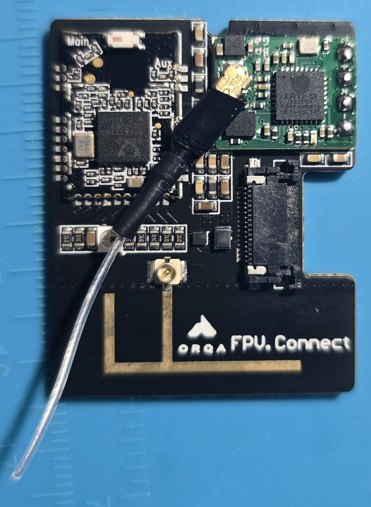
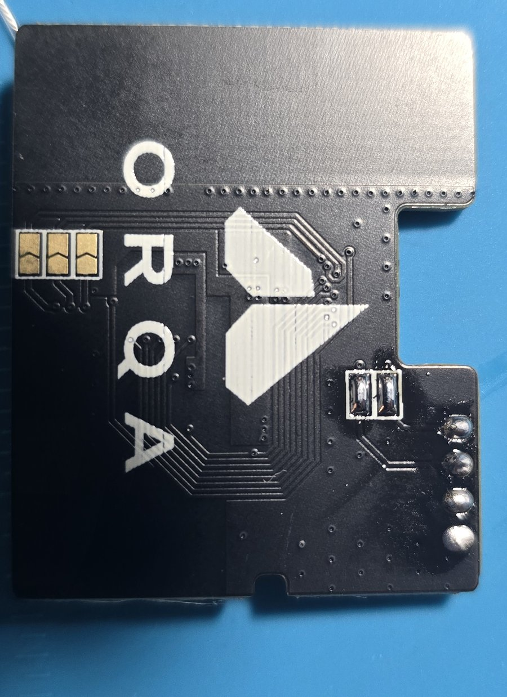

# C3HT Backpack firmware

ExpressLRS VRx backpack firmware for **C3HT** boards: an ESP32-C3 VRx backpack with an **IMU head tracker on the
board**. It does two jobs:

1. **VRx control.** Your radio's ExpressLRS TX backpack sets your goggles' (or video receiver's) band and channel.
   Some goggles get more, such as DVR record on/off.
2. **Wireless head tracking.** The on-board IMU measures pan, tilt and roll and sends them to your radio over ESP-NOW.
   The radio puts them on three channels, so you can drive a camera gimbal without a trainer cable.

**Version `1.5.9-c3ht.N` = [ExpressLRS Backpack](https://github.com/ExpressLRS/Backpack) 1.5.9 + the C3HT changes.**
This repository is a fork of ExpressLRS/Backpack. The `c3ht` branch holds the C3HT firmware, and the upstream
README is kept as [`README.upstream.md`](README.upstream.md).

## Supported goggles and video receivers

| Goggle / VRx | Link | Configurator device category | Features |
|---|---|---|---|
| Orqa (FPV.Connect) | UART, GHST at 100 kbaud | Orqa Goggles FPV.Connect | band/channel, head tracking, DVR record on/off * |
| ImmersionRC rapidFIRE | SPI | rapidFIRE Module | band/channel, head tracking |
| Skyzone SteadyView receiver | SPI | Skyzone Steadyview (SPI, DIY) | band/channel, head tracking |
| RX5808, single or diversity | SPI | RX5808 Single / Diversity Module | band/channel, head tracking |
| Skyzone goggles | UART, MSP | Skyzone Steadyview (MSP, DIY) | band/channel, DVR record, OSD, head tracking |
| TBS Fusion | UART, MSP | Fusion VRX | band/channel, link/battery telemetry, head tracking |

\* Orqa DVR on/off needs matching support in the goggle firmware. Stock Orqa firmware ignores it; band/channel and
head tracking work with stock firmware.

In the ExpressLRS Configurator the device is called **C3HT Head Tracker Backpack**.

## What the C3HT changes add to Backpack 1.5.9

- **C3HT targets**: one pin map for all C3HT boards, one build per goggle type.
- **Head tracker**:
  - ICM-42607-C driver at ±1000 dps / ±4 g with I2C bus recovery;
  - stillness-gated boot calibration;
  - run-time gyro-bias tracking with temperature compensation;
  - per-axis output scaling;
  - a measured sample period.
- **Head tracker on the Orqa build** keeps running (upstream's Orqa module skipped it).
- **Orqa DVR record on/off** over a GHST frame (type 0x23).
- **Robustness**:
  - an MSP bounds check;
  - the brownout detector armed, with brownouts counted on the web page;
  - only real power-ons count for the 3-power-cycle trigger;
  - WiFi mode ends after 5 minutes without a client;
  - queued ESP-NOW packets no longer block a reboot.
- **Radio power**: the ExpressLRS default of 19.5 dBm.

## C3HT boards

| | C3HT-Nano | C3HT-NanoA | C3HT-Mini |
|---|---|---|---|
| Radio | ESP32-C3FH4 | ESP32-C3FH4 | ESP32-C3-MINI-1 module |
| Antenna | U.FL | chip antenna | on the module |
| Size | 14.75 x 11.6 mm (Ghost Atto outline) | 16.2 x 11.6 mm | 15.7 x 25.3 mm |
| Fits | Orqa FPV.Connect slot | wired anywhere | wired anywhere; has USB, BOOT button, protection |

All boards use one pin map:

| Signal | ESP32-C3 | Pad | Use |
|---|---|---|---|
| T | IO21 (U0TXD) | hole **T** | to the goggle's UART RX; RX of a USB-UART adapter |
| R | IO20 (U0RXD) | hole **R** | from the goggle's UART TX; TX of a USB-UART adapter |
| + | – | hole **+** | supply, **3.3 to 5.5 V** |
| G | GND | hole **G** | ground |
| MOSI / CLK / CS / CS2 | IO6 / IO7 / IO10 / IO2 | bottom pads | SPI receivers (rapidFIRE, SteadyView, RX5808) |
| BOOT | IO9 | JP1 pads **B**/**G** (Nano), button (Mini) | low at power-up: download mode; short press: WiFi |
| LED | IO8 | on board | status, active low |

All GPIOs are 3.3 V and **not 5 V tolerant**.

## Installing

**Orqa FPV.Connect (C3HT-Nano)**, the same way as a Ghost Atto:

1. Power off and take the FPV.Connect module out.
2. Bridge the **two solder jumpers** on its back, next to the four pads, as shown in the ImmersionRC Ghost manual
   (photo below, right). Leave the group of three pads alone.
3. **Put insulating tape (Kapton) on the bottom of the C3HT-Nano.** Its underside has exposed test pads (BOOT, EN,
   3.3 V, SPI) that would otherwise touch the FPV.Connect.
4. Place the Nano in the Ghost Atto spot. The FPV.Connect pads read **G, +, S, T** from left to right. Connect **T to
   T, S to R, + to +, G to G** with short 30 AWG wires or header-pin offcuts, soldered through.
5. Antenna: either a small **U.FL whip** on the Nano (photo below, left), or a short U.FL-U.FL cable to the
   FPV.Connect's own 2.4 GHz PCB antenna (the U.FL socket next to the printed antenna).
6. Check that `+` and `G` are not shorted. **The Nano has no reverse-polarity protection.**
7. Power on and enable **Ghost integration** in the goggle menu.

| C3HT-Nano on the FPV.Connect, with a U.FL whip | Back: both jumpers bridged, four pads soldered |
|---|---|
|  |  |

> The FPV.Connect pads give **3.3 V**. **Never feed 5 V into `+`** while the board is soldered to the slot.

**SPI receivers** (rapidFIRE, SteadyView, RX5808): connect MOSI to DATA, CLK to CLK, CS to CS/LE, and CS2 to the
second receiver's CS for RX5808 diversity. Power the board through `+`/`G`.

**UART goggles** (Skyzone MSP, Fusion): connect T to the goggle's RX, R to the goggle's TX, then `+`/`G`.

## Flashing

**[FLASHING_C3HT.md](FLASHING_C3HT.md)** has the full guide. In short:

- **ExpressLRS Configurator (recommended):**
  1. Download the source zip from [Releases](../../releases). It includes git, so the version shows correctly.
  2. Unpack it to a short path.
  3. In the Configurator open **Backpack → LOCAL**, choose that folder, the device **C3HT Head Tracker Backpack**,
     enter your **binding phrase**, and flash over **WiFi** or **UART**.
- **Ready-built images** from [Releases](../../releases), one zip per goggle type:
  - upload `firmware.bin` on the C3HT's web page (WiFi mode, http://10.0.0.1, **Update**), or
  - flash all four files with esptool for a blank board.
- **First flash of a blank board:** use a USB-UART adapter at **3.3 V logic** on T/R/+/G, and hold BOOT low while
  powering up.

## Binding

- **Binding phrase (recommended):** build or flash with the **same phrase as your radio**.
  **Your radio's TX backpack needs the same phrase too.** Flash it in the Configurator's Backpack tab for your radio.
  A radio backpack flashed at the factory without a phrase sends nothing the C3HT listens to.
- **Without a phrase:**
  1. Power-cycle the goggles 3 times. The LED blinks twice, pauses, and repeats: binding mode for 2 minutes.
  2. Press **[Bind]** in the radio's ExpressLRS Lua.
- **Check it works:** **Enable VRx WiFi** in the Lua must switch the C3HT into WiFi mode (LED flickers fast).

## Head tracking setup

1. **Radio:** an ExpressLRS TX with a current TX backpack, bound as above. In the Lua **Backpack** folder, set the
   head-tracking switch and the start channel. Pan, tilt and roll go on three consecutive channels.
2. **C3HT web page** (WiFi mode, head-tracking page): set the **board orientation**, run the **calibration** with
   the goggles still, and **save**. **Set centre** re-centres.
3. **Aircraft:** map the three channels to the gimbal servos.

## LED

| LED | Meaning |
|---|---|
| solid on, short off-blinks | normal; each blink is a received packet |
| two blinks, pause | binding mode (2 minutes, then WiFi) |
| fast flicker | WiFi mode |

## Versions and building from source

Releases are tagged `1.5.9-c3ht.N`. A build takes its version from git: the tag on HEAD, otherwise the branch name.
So build from a git checkout (or the release source zip), not from GitHub's plain "Source code" archive, which
reports `ver.unknown`.

```
git clone --branch 1.5.9-c3ht.1 https://github.com/juricabi/c3ht-backpack-firmware
cd c3ht-backpack-firmware
pio run -e C3HT_Orqa_via_UART      # or C3HT_Rapidfire, C3HT_SteadyView, C3HT_RX5808, C3HT_SkyzoneMSP, C3HT_Fusion
```

Envs `C3HTEU_*` are an EU build with a per-device password and signed updates; they need signing keys that are not
part of this repository.

## Status

Bench-tested on a C3HT-Nano (November 2026):
- flashing, WiFi, IMU, binding by phrase;
- radio → backpack → C3HT control, with an ELRS 4.1 radio and its ESP32-C3 TX backpack.

Field tests in goggles are ongoing. Treat it as a new product: check your setup before you fly.

## License and credits

GPL-3.0, like ExpressLRS. Based on **ExpressLRS Backpack** by ExpressLRS LLC and the ExpressLRS community; see
[`README.upstream.md`](README.upstream.md) and [ExpressLRS/Backpack](https://github.com/ExpressLRS/Backpack).
